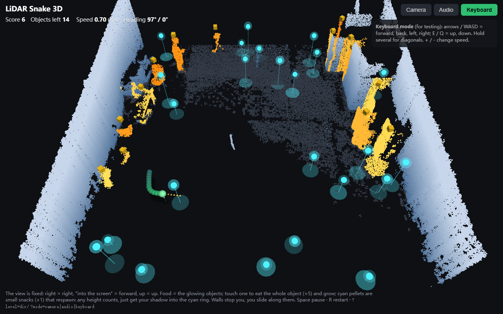
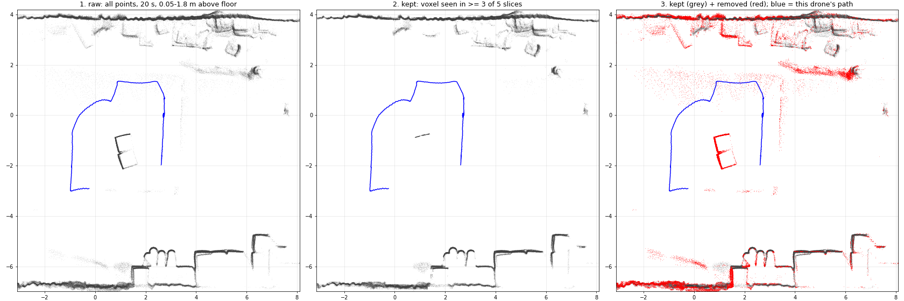
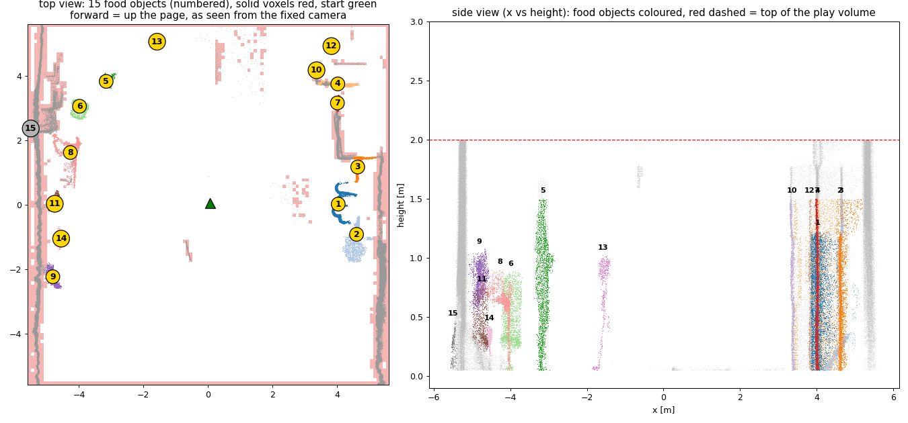

# LiDAR Snake 3D

A 3D Snake game inside a real room scanned with a Livox Mid-360 lidar. The snake flies freely through the
reconstructed point cloud, and the room's own objects are the food. You steer by **pointing your index finger at
the webcam**, or with a microphone array (audio mode, in development). Everything runs in the browser, offline,
with no build step.



## Run

```bash
./run.sh            # camera mode: serves on localhost:8000 and opens the browser
./run.sh keyboard   # keyboard mode, for testing without a camera
./run.sh audio      # audio mode, connects to ws://localhost:8765 (see AUDIO_API.md)
```
The first run downloads MediaPipe, about 37 MB, into `vendor/` (`tools/fetch_vendor.sh`). Needs Python 3 for the
static server and a browser with WebGL2. Allow camera access when the browser asks.

## How to play

- **Steer**: point with your index finger. The view is fixed, so pointing right means right, pointing at the
  screen means into the scene, and pointing up means up. Any 3D direction works; the snake turns towards it smoothly.
- **Food**: the glowing objects from the scan. Touch one to eat the whole object: +5, and the snake grows 0.3 m.
  Eat all of them to win.
- **Pellets**: 25 cyan snacks at random places, +1 each and 0.1 m of growth. A new one appears whenever one is eaten.
  Height does not matter: steer the snake's **floor shadow** into the cyan ring.
- **Walls**: real structures stop the snake and it slides along them. Hitting your own body ends the game.
- **Keys**: R restart, Space pause. Keyboard mode uses arrows / WASD plus E / Q for up / down.
- **Camera panel**: a *speed* slider, and a *depth bias* slider. A single camera tends to read a finger as
  pointing slightly towards the screen. If the snake drifts forward while you point sideways, raise it to about 0.2.

URL options: `?mode=camera|audio|keyboard`, `?pellets=N`, `?level=levels/<name>/`, `?bias=0.2`,
`?audio=ws://host:port`, `?camera=<part of the camera name>`. IR / Windows Hello cameras are skipped automatically.

## Modes

| Mode | Direction from | Speed from |
|---|---|---|
| camera | index-finger 3D direction, from MediaPipe hand landmarks | slider |
| audio | mic-array direction of arrival, via WebSocket | loudness, 0..1 → 0.15..1.8 m/s |
| keyboard | arrows / WASD / E Q | + / − keys |

Audio protocol for the mic-array program: **[AUDIO_API.md](AUDIO_API.md)**. `tools/fake_audio_server.py` is a
runnable, stdlib-only reference sender. Multiplayer is planned; the engine already supports several snakes per world.

## How the map is made

```
rosbag (Mid-360 + Point-LIO)  --map/export_scene.py-->  data/scene_0807_20-40s.pcd  --map/export_level3d.py-->  levels/hall_0807/
```

1. **`map/export_scene.py`** accumulates 20 s of Point-LIO's world-frame `/cloud_registered` from the drone flight
   `bag_0807`, t = 20–40 s. It removes moving things, here another drone, with a temporal persistence filter:
   a 10 cm voxel must be occupied in at least 3 of 5 time slices.
   
2. **`map/export_level3d.py`** turns any static PCD into a level:
   - Floor plane: deterministic RANSAC plus a least-squares refit; the cloud is levelled so the floor is z = 0.
   - Floor-to-ceiling structure: columns that also have points 1.8–3 m up become walls.
   - Objects: DBSCAN clusters in the 0.05–1.5 m band become food. Clusters longer than 2 m become walls, and
     clusters lower than 0.25 m are dropped as floor speckle.
   - Everything else visible in the 0–2 m play volume is solid.
   - Output: 0.1 m collision voxels; each object's edible zone is padded by 0.3 m.

   ```bash
   python3 map/export_level3d.py data/scene_0807_20-40s.pcd --center 2.5 -1.4 --side 11.2 --yaw-deg 90 --out levels/hall_0807
   ```
   It writes `level3d.json`, `points.bin`, `voxels.bin` and `preview.png`, a top view and a side view with
   numbered objects. The output is byte-for-byte reproducible. Open another level with `?level=levels/<name>/`.

   

Python needs `numpy scipy open3d matplotlib`, plus `rosbags` for `export_scene.py`.

## Files

| Path | What |
|---|---|
| `index.html` | the game: WebGL2 rendering, fixed camera, modes, HUD |
| `snake3d.js` | game engine, DOM-free: flight, turning, voxel collision with sliding, food, pellets, growth |
| `hand_tracker.js` | webcam + MediaPipe Hand Landmarker setup; skips IR cameras |
| `hand_direction.js` | hand → 3D direction: index-finger line fit, wrist → middle knuckle, palm normal, One Euro filter |
| `hand3d.html` | hand direction bench: 3D view, direction map, sample recording |
| `levels/hall_0807/` | the level: an 11.2 m square of the hall, 15 food objects |
| `map/` | rosbag → PCD → level |
| `data/` | the source point cloud |
| `tests/` | `node tests/test_snake3d.mjs`, `node tests/test_hand_direction.mjs` |
| `tools/` | `fetch_vendor.sh` (MediaPipe), `fake_audio_server.py` (audio test sender) |

## Credits

Hand tracking: [MediaPipe](https://github.com/google-ai-edge/mediapipe) Tasks Vision 1.2.3, Hand Landmarker
model. Lidar odometry for the scan: Point-LIO.
